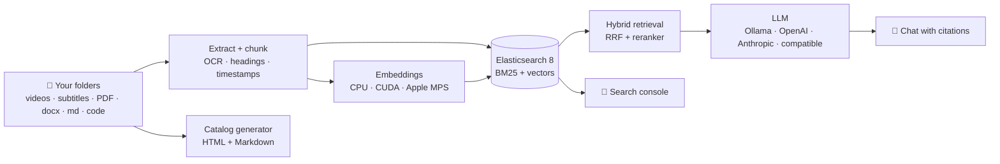

<div align="center">

# 🎓 Course Catalog Generator

**Turn any folder of courses, videos, subtitles, PDFs, Markdown and code into a searchable knowledge base — and chat with it. Local-first, offline-capable, no cloud required.**


</div>

---

## ✨ The idea

You have a big folder of learning material — recorded courses with subtitles, slide decks, PDFs, manuals, Markdown notes, code samples, ticket exports. Finding *the one minute of a video* or *the paragraph that explains a setting* is painful.

**Course Catalog Generator** does three things:

1. **📚 Builds a catalog.** It crawls the folder and generates a browsable **HTML + Markdown catalog** — videos you can play, files you can preview, notes, dark / light mode.
2. **🔎 Makes everything searchable.** Text is extracted from every format, chunked, and indexed in **Elasticsearch** for keyword (BM25), semantic (vector) and **hybrid** search — with timestamps for subtitles.
3. **💬 Lets you ask questions (RAG).** A chat answers from *your* documents, with numbered citations that open the exact file (and the exact moment of a video) — using a **local LLM** (Ollama), or optionally OpenAI, Anthropic or any OpenAI-compatible service.

Everything runs on your machine. Your documents never have to leave it.

---

## 🧰 What's inside

### 📚 Catalog generator
- Scans a directory tree (configurable depth) and writes `course_catalog.html` and `course_catalog.md`.
- Recognises videos, audio, subtitles (`.srt` / `.vtt`), images, PDFs, Office files, Markdown, code and more, with icons and previews.
- Plays videos in the page or in **VLC**, shows subtitles in sync, embeds **YouTube** links.

### 🔎 Search
| | |
|---|---|
| **BM25 full-text** | Language-aware analyzers for **German, English and Spanish**, synonyms, fuzzy matching |
| **German compound splitting** | `Schulung` finds `Schulungsunterlage`; `Ablage` finds `Dokumentenablage` |
| **Semantic (kNN)** | Multilingual embeddings (`multilingual-e5`, `bge-m3`, LaBSE, MiniLM, mpnet) — ask in Spanish, find German documents |
| **Hybrid** | BM25 + vectors fused with Reciprocal Rank Fusion |
| **Structure-aware indexing** | Markdown is chunked by headings; every chunk keeps its *title › section* as context |
| **Subtitles with timestamps** | Jump straight to the second where something is said |
| **Fallback** | FAISS index keeps semantic search alive when Elasticsearch is down |

### 💬 RAG chat
`question → LLM extracts & translates search terms (e.g. to German) → hybrid retrieval → cross-encoder rerank → grounded answer with citations`

- Streaming answers, follow-up questions with context, file-type filters.
- **Cross-encoder reranker** (multilingual) re-orders the best candidates before they reach the LLM.
- Click a citation → file viewer with the **absolute path** it was indexed from, and a clear explanation when a file is missing.
- **LLM providers** — switch in the UI (⚙ LLM), keys stay in your browser:
  **Ollama** (local models + automatic *cloud-first → local* fallback chain) · **OpenAI** · **Anthropic** · **any OpenAI-compatible API** (OpenRouter, Groq, Together, Mistral, LM Studio, vLLM…). Test the connection and list models from the UI.

### 🛠️ Tools (Search Console › Tools)
- **Index Directory** with live progress, current file, embedding ETA — and a persistent **Saved folders** list: ↻ re-scan, ✎ move a folder (the index follows), 🗑 remove.
- **Incremental re-scans** compare content hashes, so copied / synced / restored files are never lost or re-embedded.
- **Models & containers** panel: what runs in Docker, which Ollama models are loaded or used for answers, load / unload / delete, embedding & reranker status.
- **Ollama model installer** with search of the official library (sizes, ☁ cloud models).
- **Export / Import index** — pack the Elasticsearch volume into one archive and restore it on another machine (see [below](#-index-on-a-fast-machine-use-it-anywhere)).
- **OCR extract** — PDFs and images → text with PyMuPDF, PDFMiner, Tesseract, EasyOCR, PaddleOCR or an **Ollama vision** model.
- **Video & Markdown helpers** *(optional companions)* — YouTube downloader, PDF collector, Markdown translator / splitter / formatter / image downloader, HTML → Markdown converter. The menu launches them if they are present next to the project; **they are not bundled in this repository**.
- Background workers for **translation** to a canonical language and **analytics**.

---

## 🧱 Architecture



- **Backend:** Python + Flask (REST, SSE streaming, WebSocket search). **Frontend:** plain HTML / CSS / JavaScript — no build step.
- **Elasticsearch** runs in Docker (`deploy/docker-compose.yml`); Python talks to it directly.

---

## 🚀 Quick start

**Requirements:** Python 3.9+, Docker (for Elasticsearch), and [Ollama](https://ollama.com) if you want local answers.

```bash
git clone https://github.com/patchamama/Course-catalog-generator.git
cd Course-catalog-generator

# macOS / Ubuntu                     # Windows
./start.sh                           start.bat
```

The launcher opens a progress page, creates a virtualenv, installs the dependencies, checks Elasticsearch and Ollama, starts the backend and opens the app at <http://localhost:5000>. On first start `backend/env.py` is created from [`backend/env.example.py`](backend/env.example.py) — set your folders there (or just use **Tools › Index Directory**).

```bash
# Elasticsearch only (Docker)
docker compose -f deploy/docker-compose.yml up -d elasticsearch

# Full Docker stack (Elasticsearch + backend + indexer)
./deploy/start-docker.sh           # deploy\start-docker.bat on Windows
```

Then open **Search Console → Tools → Index Directory**, pick a folder, and index it. Open **Chat** to ask questions.

> **Ubuntu:** `sudo apt install python3-venv` if the launcher asks for it, and make sure your user is in the `docker` group.
> **macOS:** `brew install python@3.12`; Docker Desktop for Elasticsearch; install **Ollama natively** (Docker on macOS cannot use the GPU).

---

## ⚡ Index on a fast machine, use it anywhere

Embedding is the slow part. Index on a powerful machine — for example an **Apple-Silicon Mac** (GPU through PyTorch **MPS**) or an NVIDIA box — with a bigger model, then move the finished index:

1. On the fast machine set `EMBEDDING_MODEL = "BAAI/bge-m3"` (or `intfloat/multilingual-e5-large`) in `backend/env.py`; the GPU is picked automatically (`EMBEDDING_DEVICE = auto | cuda | mps | cpu`). Index your folders.
2. **Tools › Export / Import index › Create export.** The backend stops Elasticsearch, packs its Docker volume into one `.tgz` with a manifest and checksum, and restarts it — with step-by-step progress.
3. Copy the `.tgz` (and its `.manifest.json`) to the other machine, set the **same** `EMBEDDING_MODEL`, and use **Import & replace**. It validates the file, optionally makes a safety backup, unpacks, restarts Elasticsearch and verifies the document count.
4. The UI then lists the **old folders** the documents came from — type where they live on this machine and the index is re-pointed.

> **Heads-up:** the Apple-Silicon (MPS) path is implemented (unsupported operations fall back to the CPU), but the author has not run it on Apple hardware yet — treat it as experimental. The export / import flow is tested end to end with Docker on Windows.

---

## 🔌 Offline & privacy

- **Search, indexing, the RAG chat with local models, OCR and the file viewer work without internet.**
- The only network traffic is **optional**: the first download of models (Hugging Face / Ollama), cloud LLMs *if you configure them*, and a few front-end scripts from a CDN (Markdown rendering, syntax highlighting) which have built-in fallbacks.
- API keys for external LLMs live in your **browser's localStorage** and are forwarded by your own backend per request — never stored or logged server-side.
- Export / import and other destructive Docker actions are accepted from **localhost only**.

---

## ⚙️ Configuration

Edit `backend/env.py` (template: [`env.example.py`](backend/env.example.py)); every key can also be an environment variable.

| Setting | Default | Purpose |
|---|---|---|
| `SEARCH_BASE_PATH` | `~/Courses` | Folders that may be served (`;`-separated) |
| `ES_URL` / `ES_INDEX` | `http://127.0.0.1:9200` / `course_catalog` | Elasticsearch endpoint and index |
| `EMBEDDING_MODEL` | `intfloat/multilingual-e5-small` | Must match between index and queries |
| `EMBEDDING_DEVICE` | `auto` | `cuda`, `mps` (Apple GPU) or `cpu` |
| `RERANK_ENABLED` / `RERANKER_MODEL` | `True` / light multilingual | Cross-encoder reranking |
| `RAG_TRANSLATE_QUERY_TO` | `de` | Translate search terms into the language of your documents |
| `NO_VECTOR_EXTENSIONS` | `json,xml,js,ts,css` | BM25-only types (faster indexing) |
| `OLLAMA_URL` | `http://127.0.0.1:11434` | Local Ollama |

---

## 🗂️ Project structure

```
backend/      Flask server, indexer, RAG, rerank, LLM providers, export/import, OCR, workers
frontend/     search-console.html · chat.html · ocr-extract.html · startup.html · assets/
deploy/       docker-compose.yml, Dockerfile, start-docker.sh/.bat, setup scripts
tools/        launcher (visual startup), desktop wrapper, packaging (PyInstaller)
docs/         server API, Elasticsearch setup, search architecture, LLM models
tests/        benchmark & regression scripts (embedding model comparison, search quality)
```

## 🖥️ Desktop app (optional)

Package it as a native app with PyInstaller + pywebview:

```bash
pip install pyinstaller pywebview
python3 tools/package/build.py            # auto-detects macOS / Windows / Linux
```

## 📖 Documentation

- [Server API reference](docs/CATALOG_SERVER_README.md)
- [Elasticsearch setup, retrieval quality, moving the index](docs/ELASTICSEARCH_README.md)
- [Search architecture](docs/SEARCH_ARCHITECTURE.md) · [Language-agnostic search](docs/language_agnostic_search.md)
- [Choosing LLM models & recovering from provider errors](docs/llm-models.md)

---

<div align="center">

Built for people who learn from a lot of material and want to *find* things in it. Contributions and issues are welcome.

</div>
