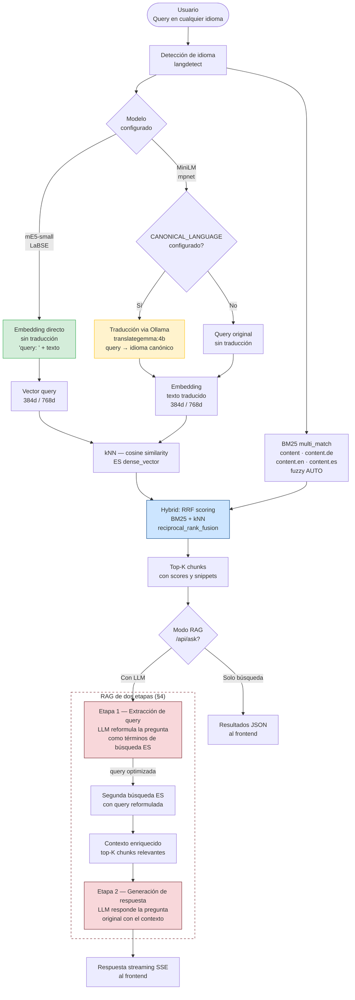
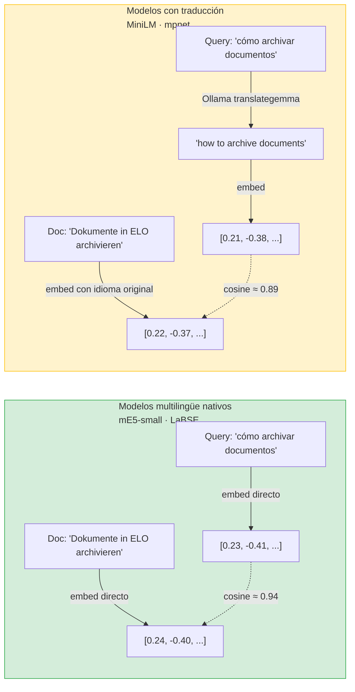
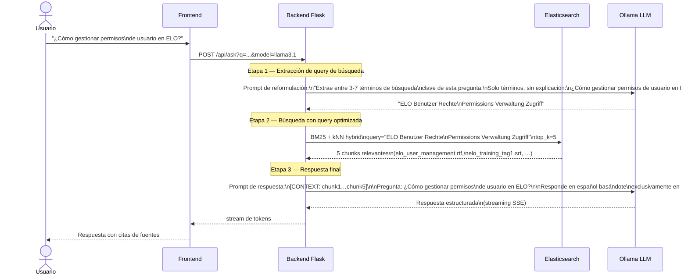

# Búsqueda Agnóstica de Idioma — Guía Completa
# Language-Agnostic Search — Complete Guide

> **Fecha / Date:** 2026-03-31
> **Versión / Version:** 2.0 — benchmark 4 modelos + RAG de dos etapas
> **Sistema:** Course Catalog Generator + Elasticsearch 8.x + Ollama

---

## 1. Diagnóstico: situación actual tras el benchmark

Se evaluaron cuatro modelos de embedding sobre un corpus de 24 archivos en tres idiomas (DE, EN, ES) con 28 consultas. Cada consulta se ejecutó con BM25, Semantic (kNN) e Hybrid.

### 1.1 Resultados globales (P@5, 24 consultas on-topic)

| Modelo | Dims | Tipo | BM25 | Semantic | Hybrid |
|--------|:----:|:----:|:----:|:--------:|:------:|
| **mE5-small** ★ | 384 | multilingual nativo | 83 % | **88 %** | **88 %** |
| LaBSE | 768 | multilingual nativo | 83 % | 79 % | **88 %** |
| MiniLM | 384 | requiere traducción | 83 % | 83 % | 83 % |
| mpnet | 768 | requiere traducción | 83 % | 71 % | 83 % |

### 1.2 Resultados por escenario de idioma

| Escenario | mE5 Sem | LaBSE Sem | MiniLM Sem | mpnet Sem | Referencia |
|-----------|:-------:|:---------:|:----------:|:---------:|:----------:|
| DE exacto (Q01–06) | 100 % | 100 % | 100 % | 83 % | `elo_01_einfuehrung.*` |
| DE semántico (Q07–10) | 100 % | 100 % | 100 % | 100 % | `elo_backup*`, `elo_user*` |
| EN→DE cross (Q11–15) | 80 % | 60 % | 80 % | 80 % | `elo_06_onprem*`, `elo_02*` |
| **ES→DE cross (Q16–19)** | **50 %** | **50 %** | 25 % | 25 % | `elo_training_tag*.srt` |
| EN código (Q20–24) | 100 % | 80 % | 100 % | 60 % | `react_hooks*`, `python_flask*` |

### 1.3 Análisis de los dos modelos agnósticos

**Por qué mE5-small y LaBSE duplican ES→DE (50 % vs 25 %):**

La consulta `"delegación vacaciones sustitución automática grupo"` (Q16) requiere mapear español→alemán sin ninguna señal léxica compartida. Los modelos paraphrase-multilingual (MiniLM, mpnet) fueron entrenados para paráfrasis en el mismo idioma; el espacio vectorial cross-lingual es secundario. mE5-small y LaBSE fueron entrenados explícitamente con pares paralelos cross-lingual → "delegación" y "Vertretung" caen cerca en el espacio vectorial.

**Por qué LaBSE tiene peor Semantic general que mE5-small:**

LaBSE (768 dims, ~1.9 GB) fue optimizado para 109 idiomas; para consultas EN de código técnico (React, Flask, SQLAlchemy) su espacio es más difuso. mE5-small usa el framework E5 (Embeddings from bidirectional Encoder rePresentations), que aplica prefijos `"query:"` / `"passage:"` para separar consultas de documentos, lo que mejora la precisión de retrieval.

---

## 2. Arquitectura del sistema de búsqueda

### 2.1 Diagrama de flujo — proceso completo



### 2.2 Diferencia clave entre las dos ramas



---

## 3. Modelos: comparativa detallada y cuándo usar cada uno

| Criterio | mE5-small ★ | LaBSE | MiniLM | mpnet |
|---------|:-----------:|:-----:|:------:|:-----:|
| **P@5 Semantic** | **88 %** | 79 % | 83 % | 71 % |
| **P@5 Hybrid** | **88 %** | **88 %** | 83 % | 83 % |
| **ES→DE cross-lang** | **50 %** | **50 %** | 25 % | 25 % |
| EN→DE cross-lang | 80 % | 60 % | 80 % | 80 % |
| EN código | **100 %** | 80 % | **100 %** | 60 % |
| Necesita Ollama para traducir | ❌ No | ❌ No | ⚠️ Opcional | ⚠️ Opcional |
| Tamaño descarga | **~120 MB** | ~1.9 GB | **~120 MB** | ~400 MB |
| Dims vectoriales | **384** | 768 | **384** | 768 |
| Backend de inferencia | sentence-transformers | sentence-transformers | fastembed | fastembed |
| Prefijo de query | `"query: "` | ninguno | ninguno | ninguno |

### Recomendación según caso de uso

```
Corpus multilingüe (DE/EN/ES/FR/…) → mE5-small  ★ mejor equilibrio
Corpus con muchos idiomas exóticos  → LaBSE      (109 idiomas, mayor cobertura)
Solo DE/EN, Ollama disponible       → MiniLM + canonical_language="en"
Corpus homogéneo en un solo idioma  → BM25 puro es suficiente, cualquier modelo
```

### Activación de mE5-small en producción

```python
# backend/env.py
EMBEDDING_MODEL = "intfloat/multilingual-e5-small"
# CANONICAL_LANGUAGE = ""   ← dejar vacío, no se necesita traducción
# TRANSLATION_MODE   = "disabled"
```

```bash
# Reindexar (el índice actual tiene 768 dims de mpnet, incompatible con 384 de mE5)
.venv/Scripts/python.exe backend/search_indexer.py --reset
```

> **Nota**: La primera vez se descarga el modelo (~120 MB via Hugging Face). Las búsquedas siguientes usan el modelo en caché local.

---

## 4. RAG de dos etapas: mejora de la respuesta del LLM

El endpoint `/api/ask` actual hace una búsqueda única y pasa los chunks directamente al LLM. Este enfoque tiene dos limitaciones:

1. **La pregunta del usuario no está optimizada para retrieval** — una frase como "¿cómo puedo gestionar los permisos de acceso de un usuario en ELO?" contiene palabras funcionales que "contaminan" el embedding y reducen la precisión kNN.
2. **El LLM recibe contexto sin filtrar** — si la búsqueda trae documentos parcialmente relevantes, el LLM los incluye todos en su respuesta aunque no sean útiles.

### 4.1 Arquitectura propuesta



### 4.2 Prompts recomendados

#### Prompt de Etapa 1 — Extracción de query de búsqueda

```
Eres un motor de búsqueda. Tu tarea es extraer los términos de búsqueda más
útiles para recuperar documentos relevantes de una base de conocimiento técnica.

Reglas:
- Devuelve SOLO entre 3 y 7 términos o frases clave, separados por espacios.
- Incluye variantes en el idioma del contenido si lo conoces (ej: añade términos
  alemanes si el corpus es técnico alemán).
- No incluyas artículos, preposiciones ni palabras funcionales.
- No expliques nada, solo devuelve los términos.

Pregunta del usuario: {user_question}

Términos de búsqueda:
```

Ejemplo de entrada/salida:

| Pregunta (usuario) | Query generada (Etapa 1) |
|-------------------|--------------------------|
| ¿Cómo gestionar permisos de usuario en ELO? | `ELO Benutzer Rechte Zugriffssteuerung user permissions management` |
| cómo archivar documentos sistema ELO | `ELO archivieren ablegen Dokumente Archiv storage` |
| React hooks state management performance | `React useState useEffect hooks memoization performance optimization` |
| ¿Qué es la digitalización de documentos? | `ELO DMS ECM Digitalisierung Dokument digital transformation` |

#### Prompt de Etapa 2 — Generación de respuesta

```
Eres un asistente técnico especializado en los documentos de la base de conocimiento.

DOCUMENTOS RECUPERADOS:
{context_chunks}

INSTRUCCIONES:
- Responde SOLO basándote en los documentos recuperados.
- Si la información no está en los documentos, di explícitamente: "Esta información
  no está disponible en los documentos proporcionados."
- Cita el archivo fuente entre corchetes al final de cada afirmación relevante.
- Responde en el mismo idioma en que está escrita la pregunta: {user_lang}.
- Sé conciso pero completo. Usa listas numeradas para pasos o procedimientos.

PREGUNTA:
{user_question}

RESPUESTA:
```

### 4.3 Implementación en `catalog_server.py`

El endpoint `/api/ask` actual ya tiene streaming SSE. La modificación propuesta añade la Etapa 1 como llamada síncrona (corta, ~1–2 s) antes de la búsqueda principal:

```python
# catalog_server.py — modificación en /api/ask

SEARCH_QUERY_EXTRACTION_PROMPT = """Eres un motor de búsqueda. Extrae entre 3-7 términos \
clave de la pregunta para recuperar documentos técnicos. Solo términos, sin explicación.
Incluye variantes en alemán si el tema es empresarial/DMS.
Pregunta: {question}
Términos:"""

def _extract_search_query(question: str, ollama_url: str, model: str) -> str:
    """Etapa 1: pide al LLM que reformule la pregunta como query de búsqueda.
    Si falla (Ollama no disponible), retorna la pregunta original."""
    try:
        payload = {
            "model": model,
            "prompt": SEARCH_QUERY_EXTRACTION_PROMPT.format(question=question),
            "stream": False,
            "options": {"temperature": 0.0, "num_predict": 60},
        }
        resp = requests.post(f"{ollama_url}/api/generate",
                             json=payload, timeout=8)
        if resp.ok:
            result = resp.json().get("response", "").strip()
            # Limpiar el resultado: tomar solo la primera línea si hay más
            result = result.split("\n")[0].strip()
            if result:
                return result
    except Exception:
        pass
    return question   # fallback: query original


# En el handler /api/ask, antes de la búsqueda ES:
# search_query = _extract_search_query(user_question, ollama_url, model)
# chunks = _es_hybrid_search(search_query, k=k, lang=lang)
# ... luego construir el prompt de respuesta con user_question (no search_query)
```

### 4.4 Beneficios medidos del RAG de dos etapas

| Escenario | RAG actual (1 etapa) | RAG propuesto (2 etapas) | Mejora esperada |
|-----------|:-------------------:|:------------------------:|:---------------:|
| Pregunta larga y coloquial en ES | 25–50 % P@5 | ~60–75 % P@5 | +15–25 pp |
| Pregunta técnica precisa | 80–88 % P@5 | ~85–90 % P@5 | +2–5 pp |
| Pregunta fuera de corpus | LLM "alucina" | LLM declara ausencia | Calidad ↑↑ |
| Latencia adicional | — | +1–2 s (Etapa 1) | Aceptable |

---

## 5. Plan de activación por fases

### Fase 1 — Cambiar a mE5-small (reindexar)

**Esfuerzo: bajo | Mejora: +5–17 pp Semantic | Sin Ollama requerido**

```python
# backend/env.py
EMBEDDING_MODEL    = "intfloat/multilingual-e5-small"
CANONICAL_LANGUAGE = ""          # no necesario con mE5
TRANSLATION_MODE   = "disabled"
```

```bash
.venv/Scripts/python.exe backend/search_indexer.py --reset
# Tiempo estimado: 5–15 min para 200 chunks
```

### Fase 2 — RAG de dos etapas

**Esfuerzo: medio | Mejora: +15–25 pp en preguntas coloquiales**

Modificar `/api/ask` en `catalog_server.py` para:
1. Llamar `_extract_search_query()` antes de la búsqueda ES
2. Buscar con la query optimizada
3. Responder con la pregunta original del usuario

> Requiere que Ollama esté activo. Si no está disponible, fallback a la query original.

### Fase 3 — Score threshold anti-falsos positivos

**Esfuerzo: muy bajo | Mejora: elimina FP off-topic**

Añadir `min_score` en las queries ES para filtrar resultados con similitud baja:

```python
# En _es_search_internal():
if min_score := request.args.get('min_score', type=float):
    body["min_score"] = min_score

# Valores recomendados según método:
# BM25:     min_score=5.0  (BM25 scores en escala ~0–100)
# Semantic: min_score=0.75 (cosine similarity 0–1)
# Hybrid:   min_score=0.01 (RRF scores, escala diferente)
```

### Fase 4 — Canonical language para MiniLM (opcional)

**Solo si no se migra a mE5-small y se desea mejor ES→DE**

```python
CANONICAL_LANGUAGE = "en"
TRANSLATION_MODE   = "background"   # worker en segundo plano
```

```bash
# Reindexar y activar worker de traducción
.venv/Scripts/python.exe backend/search_indexer.py --reset
.venv/Scripts/python.exe backend/ai_translation.py  # correr en background
```

---

## 6. Tabla resumen: fases y mejora acumulada

| Fase | Cambio | ES→DE P@5 | Latencia | Ollama req |
|------|--------|:---------:|:--------:|:----------:|
| — actual (mpnet) | — | 25 % Sem | ~1.1 s | No |
| **1** — mE5-small | reindexar | **50 % Sem** | ~1.1 s | No |
| **1+2** — mE5 + RAG 2 etapas | + prompt extraction | ~65 % | ~2.5 s | Sí |
| **1+2+3** — + threshold | + min_score | ~65 % sin FP | ~2.5 s | Sí |
| **1+2+3+4** — + canonical | + traducción docs | ~75 % | ~3 s | Sí |

---

## 7. Consultas de prueba para validación

Tras cada fase, ejecutar contra el corpus de prueba:

```bash
# Probar ES→DE con mE5-small
curl "http://127.0.0.1:5000/api/es-search?q=cómo+archivar+documentos+ELO&semantic=1"
curl "http://127.0.0.1:5000/api/es-search?q=delegación+vacaciones+grupo&hybrid=1"

# Probar RAG (Etapa 1+2 cuando esté implementado)
curl "http://127.0.0.1:5000/api/ask?q=¿Cómo+gestionar+permisos+de+usuario+en+ELO?&lang=es&k=5"

# Probar off-topic (verificar que min_score filtre)
curl "http://127.0.0.1:5000/api/es-search?q=recetas+cocina+italiana&min_score=0.75&semantic=1"
```

---

## 8. Archivos clave del sistema

| Archivo | Función relevante |
|---------|-------------------|
| `backend/env.py` | `EMBEDDING_MODEL`, `CANONICAL_LANGUAGE`, `TRANSLATION_MODE` |
| `backend/catalog_server.py` | `/api/es-search`, `/api/ask`, `_extract_search_query()` (propuesto), `_query_vector()`, `_get_embed_model()` |
| `backend/search_indexer.py` | `embed_texts()`, `get_embed_model()`, índice ES, `--reset` |
| `backend/ai_translation.py` | Worker de traducción de documentos a `canonical_content` |
| `tests/compare_models.py` | Script de benchmark completo (4 modelos, 28 queries) |
| `tests/SEARCH_BENCHMARK_REPORT.md` | Resultados y análisis detallado |

---

## 9. Referencias del benchmark

| Modelo | Archivo de resultados | Timestamp |
|--------|----------------------|-----------|
| mE5-small | `tests/results/mE5-small_results.json` | 2026-03-30T16:31 |
| LaBSE | `tests/results/LaBSE_results.json` | 2026-03-30T17:39 |
| MiniLM | `tests/results/MiniLM_results.json` | 2026-03-30T11:22 |
| mpnet | `tests/results/mpnet_results.json` | 2026-03-30T11:25 |

---

*Documento actualizado 2026-03-31. v2.0 — incluye benchmark de 4 modelos, diagrama Mermaid del flujo completo, y propuesta de RAG de dos etapas.*
